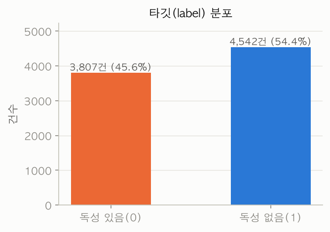
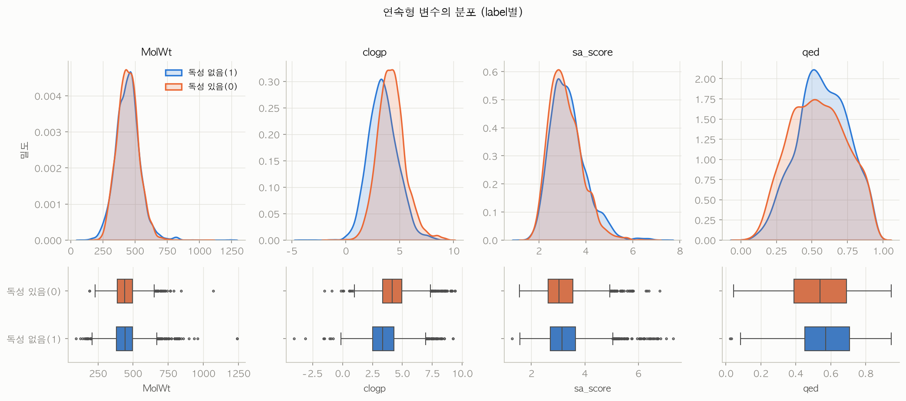
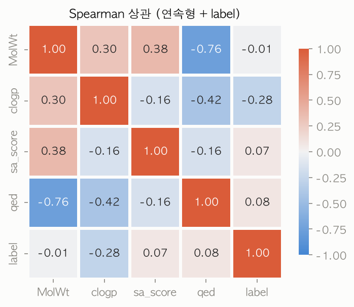
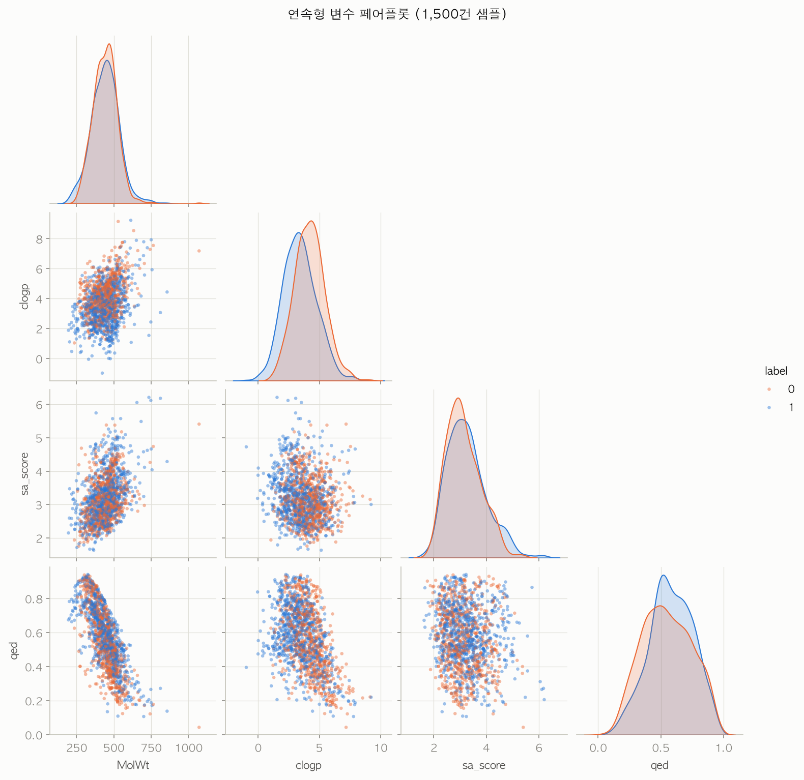
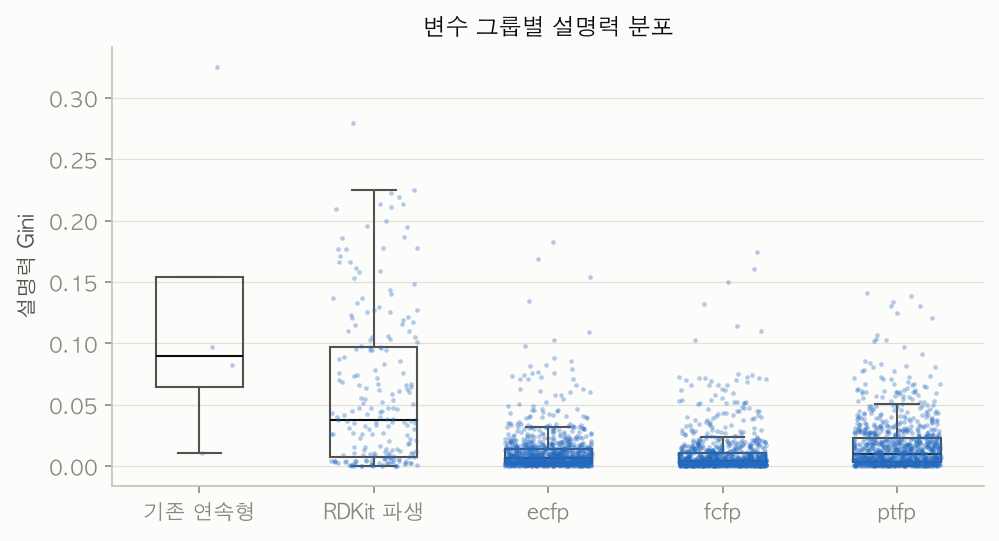
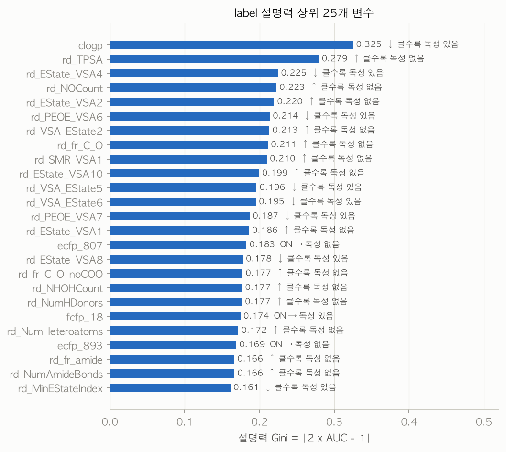
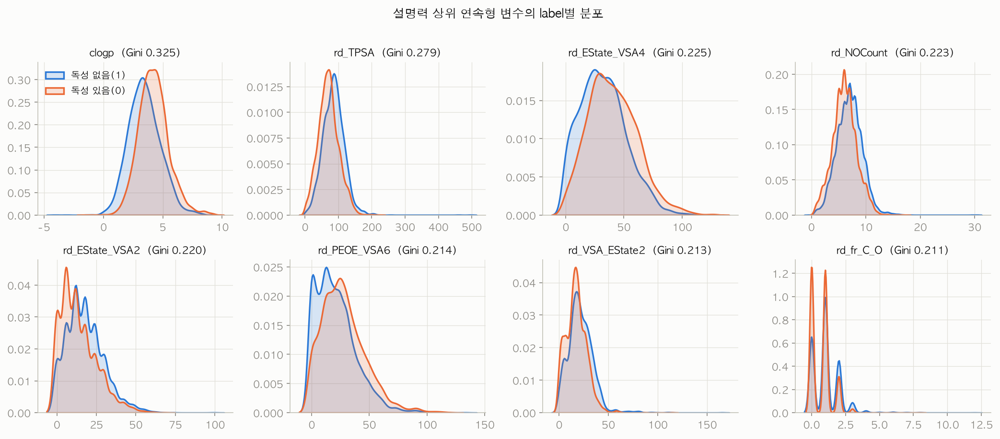
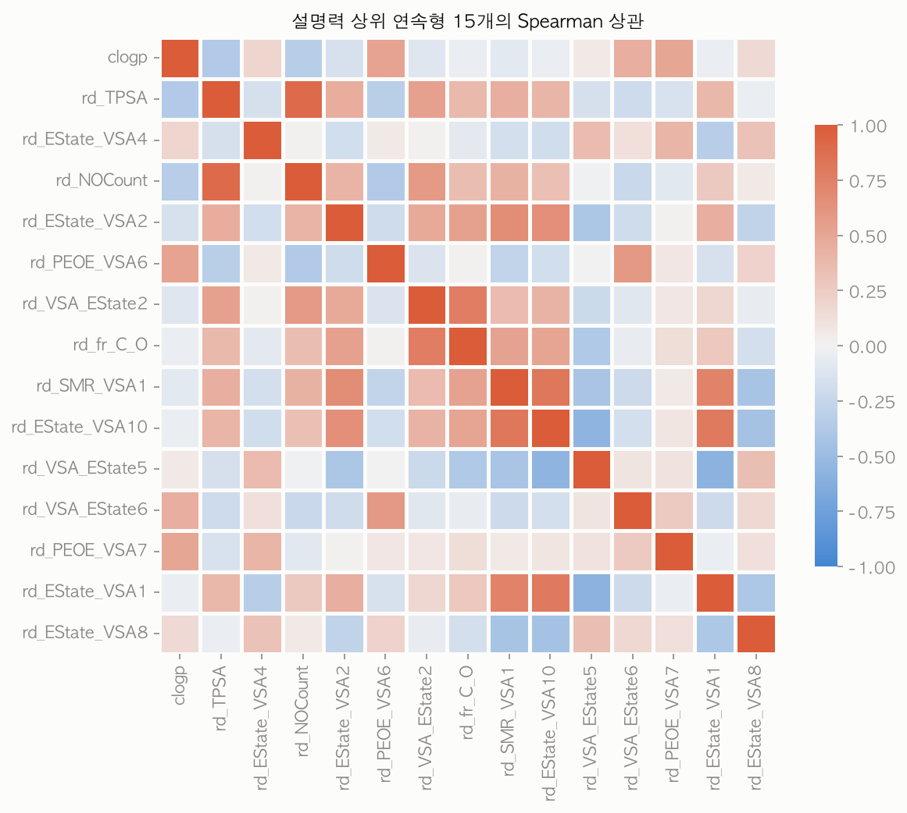
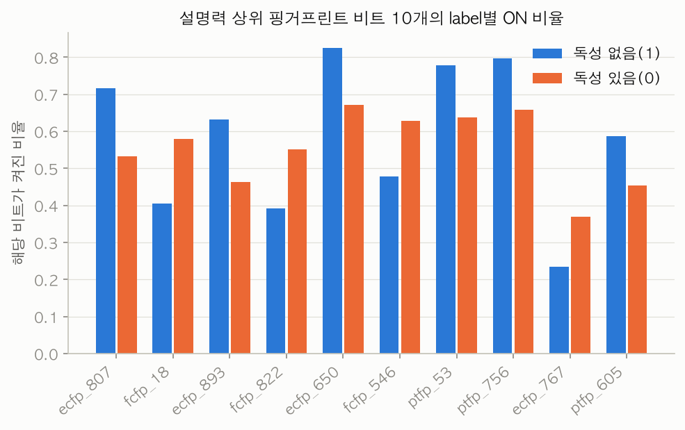

# 신약 후보물질 독성 예측 - EDA 보고서 (Day1)

- 데이터: `data/train.csv` (8,349건 × 3,078열), 과제: 이진 분류, 평가지표: **F1-score** (Positive = `label` 1 = 독성 없음)
- 범위: EDA까지만 수행했고 모델링은 하지 않았다.
- 초점: **각 컬럼이 종속변수 `label`(독성 여부)을 얼마나 설명하는가**
- 재현: `eda.ipynb`를 위에서부터 실행하면 아래 수치와 그림(`reports/figures/`), 표(`reports/tables/`)가 모두 다시 만들어진다.

## 1. 핵심 요약

1. **라벨 의미 주의: `label` 1 = 독성 없음, 0 = 독성 있음.** 분포는 1이 54.4%(4,542건), 0이 45.6%(3,807건)로 불균형이 크지 않다.
2. 결측값, SMILES 중복, SMILES 파싱 실패가 모두 0건이라 정제 부담이 작다.
3. **개별 변수의 설명력은 전반적으로 약하다.** 전체 3,231개 변수 중 가장 큰 설명력(Gini)이 0.325(`clogp`)이고, Gini 0.2를 넘는 변수는 9개뿐이다.
4. 설명력 상위는 **`clogp`(지용성)와 극성 관련 RDKit 파생변수(`rd_TPSA`, `rd_NOCount` 등)** 이다. 지용성이 높을수록 독성 있음, 극성이 높을수록 독성 없음 쪽이다.
5. 핑거프린트 비트는 개별 비트의 설명력이 가장 작다(Gini 최대 0.18). 다만 유의한 비트는 1,200개 이상이라 **약한 신호가 많은 열에 분산**돼 있다.
6. F1 기준선(전부 1로 예측)이 이미 **0.705**다. 변수 하나로 만든 최선의 단순 규칙도 최대 0.713(`rd_fr_sulfide`)에 그쳤다. 개별 변수만으로는 기준선과 거의 같고, 조합 효과는 Day2에서 검증해야 한다.

## 2. 데이터 구조와 품질

| 항목 | 결과 |
|---|---|
| 크기 | 8,349행 × 3,078열 (SMILES 1, 핑거프린트 3,072, 연속형 4, label 1) |
| 메모리 | 206MB → 27MB (핑거프린트 0/1을 `uint8`로 변환) |
| 결측값 | 0 |
| SMILES | 고유 8,349개, 중복 0, RDKit 파싱 실패 0 |
| SMILES 길이 | 최소 9, 중앙값 55, 최대 249 |

핑거프린트는 모두 희소하다(`reports/tables/fingerprint_quality.csv`).

| 그룹 | 행당 ON 비트 평균 | 상수열 | ON 1% 미만 | ON 99% 초과 |
|---|---|---|---|---|
| ecfp | 56.2 | 0 | 98 | 1 |
| fcfp | 44.9 | 0 | 422 | 2 |
| ptfp | 433.7 | **49** | 34 | 166 (상수열 49 포함) |

`ptfp` 상수열 49개는 정보가 없으므로 제거 후보다.

## 3. 타깃 변수

- label 1(독성 없음) 4,542건(54.4%), label 0(독성 있음) 3,807건(45.6%)
- 균형에 가까워서 층화 분할(`stratify=y`)만으로 충분해 보인다.
- **F1 기준선**: 전부 1로 예측하면 F1 = 0.7047, 전부 0으로 예측하면 0이다. Positive 비율이 54%라서 "무조건 독성 없음"이라고 찍어도 F1이 높게 나온다. 모델 F1은 0.705와 비교해서 읽어야 한다.

## 4. 연속형 4개 변수 (MolWt, clogp, sa_score, qed)

### 4.1 단변량

| 변수 | 평균 | 중앙값 | 왜도 | 첨도 | IQR 이상치 |
|---|---|---|---|---|---|
| MolWt | 443.2 | 441.5 | 0.57 | 2.89 | 130건 (1.56%) |
| clogp | 3.80 | 3.74 | 0.25 | 0.70 | 137건 (1.64%) |
| sa_score | 3.19 | 3.09 | 0.89 | 1.45 | 158건 (1.89%) |
| qed | 0.56 | 0.56 | -0.05 | -0.70 | 0건 |

- 왜도가 가장 큰 `sa_score`(0.89)도 심한 편은 아니다. 로그 변환은 필수가 아니다.
- 이상치는 `MolWt`, `clogp`, `sa_score`가 1.6~1.9% 수준이고 `qed`는 0건이다. `MolWt` 최대 1,242, `sa_score` 최대 7.31이 극단값이다.

### 4.2 label에 대한 설명력

| 변수 | AUC | Gini | 방향 | Cohen's d | Spearman ρ | Mann-Whitney p | 단일 규칙 최고 F1* |
|---|---|---|---|---|---|---|---|
| **clogp** | 0.338 | **0.325** | 클수록 독성 있음 | -0.57 | -0.28 | < 1e-140 | 0.707 |
| qed | 0.549 | 0.097 | 클수록 독성 없음 | 0.17 | 0.08 | 유의 | 0.705 |
| sa_score | 0.541 | 0.083 | 클수록 독성 없음 | 0.16 | 0.07 | 유의 | 0.705 |
| MolWt | 0.495 | 0.011 | 거의 없음 | -0.01 | -0.01 | 0.40 (유의하지 않음) | 0.705 |

\* 변수 하나, 임계값 하나, 방향 선택으로 만든 규칙의 최대 F1이다. 전체 train에서 임계값을 골랐으므로 낙관적인 참고치다. 탐색 후보에 "전부 1" 규칙이 늘 들어가므로 이 값은 기준선 0.705보다 낮아질 수 없다. 0.705로 나온 변수는 기준선보다 나은 규칙을 찾지 못했다는 뜻이다(연속형 208개 중 145개).

- **`clogp`만 뚜렷하다.** 독성 없음 평균 3.45, 독성 있음 평균 4.21로 독성 있는 쪽이 더 지용성이다.
- `qed`, `sa_score`는 p값이 작지만 효과 크기(d ≈ 0.16~0.17)가 작다. 표본이 커서 유의하게 나온 것이다.
- **`MolWt`는 label을 설명하지 않는다**(Gini 0.011, p = 0.40).

### 4.3 변수 간 관계

- `MolWt`와 `qed`의 상관이 **-0.76**으로 강하다. `qed`와 `clogp`도 -0.42다. 선형 모델을 쓴다면 다중공선성을 고려해야 한다.
- label과 가장 강한 관계는 `clogp`(-0.28)다. 산점도에서 두 클래스가 크게 겹쳐서 2변수만으로 분리되지는 않는다.

## 5. SMILES 파생변수 (RDKit)

- RDKit 분자 기술자 217개를 계산했다(`features.py`의 `compute_rdkit_descriptors`). 파싱 실패 0건.
- **SMILES는 파생변수를 만든 뒤 변수로 쓰지 않는다.** 8,349개가 모두 고유한 문자열이라 식별자에 가깝다.
- 처리 내역:
  - 상수 기술자 10개 제거 (`rd_fr_azo`, `rd_fr_epoxide` 등).
  - 기존 컬럼과 같은 기술자 3개 제거: `rd_MolWt`, `rd_MolLogP`, `rd_qed`. 각각 `MolWt`, `clogp`, `qed`와 Spearman 상관이 1.0이다. **기존 `clogp`는 RDKit의 MolLogP와 같은 값**이다.
  - `rd_BCUT2D_*` 8개 기술자는 7건에서 결측이어서 중앙값으로 대체했다(탐색용. Day2에서는 분할 후 학습 데이터 기준으로 다시 해야 한다).
  - 최종 파생변수 204개. 이 중 |Spearman| > 0.95인 쌍이 66개로, 서로 정보가 많이 겹친다.

## 6. 변수별 설명력 비교 (핵심)

모든 변수에 같은 지표를 썼다. `Gini = |2·AUC − 1|`이고, 비트 변수에서는 `|TPR − FPR|`과 같다. 유의성은 연속형은 Mann-Whitney U, 비트는 카이제곱으로 구했고 전체 3,231개 변수에 Benjamini-Hochberg 보정(q)을 적용했다. 전체 표는 `reports/tables/feature_explanatory_power.csv`에 있다.

### 6.1 그룹별 요약

| 그룹 | 변수 수 | Gini 최대 | Gini 중앙값 | Gini > 0.1 | q < 0.05 (비율) |
|---|---|---|---|---|---|
| 기존 연속형 | 4 | 0.325 | 0.090 | 1 | 3 (75.0%) |
| RDKit 파생 | 204 | 0.279 | 0.038 | 50 | 139 (68.1%) |
| ecfp | 1,024 | 0.183 | 0.007 | 6 | 449 (43.8%) |
| fcfp | 1,024 | 0.174 | 0.004 | 7 | 383 (37.4%) |
| ptfp | 975 | 0.141 | 0.010 | 11 | 454 (46.6%) |

(ptfp는 상수열 49개를 뺀 975개를 검정했다.)

- **연속형 계열(기존 + RDKit 파생)이 비트 계열보다 변수당 설명력이 크다.** 중앙값이 0.04~0.09로, 비트의 0.004~0.010보다 약 4~22배 크다.
- 비트는 개별 설명력이 작지만 유의한 비트가 1,286개(449 + 383 + 454)나 된다. 하나씩은 약하고 여러 개가 같이 움직인다고 볼 수 있다.
- 전체 3,231개 중 q < 0.05는 1,428개다. 유의하다는 것과 설명력이 크다는 것은 다르다. 표본이 커서 작은 차이도 유의하게 나온다.

### 6.2 상위 변수

| 순위 | 변수 | 그룹 | Gini | 방향 |
|---|---|---|---|---|
| 1 | clogp | 기존 | 0.325 | 클수록 독성 있음 |
| 2 | rd_TPSA | RDKit | 0.279 | 클수록 독성 없음 |
| 3 | rd_EState_VSA4 | RDKit | 0.225 | 클수록 독성 있음 |
| 4 | rd_NOCount | RDKit | 0.223 | 클수록 독성 없음 |
| 5 | rd_EState_VSA2 | RDKit | 0.220 | 클수록 독성 없음 |
| 6 | rd_PEOE_VSA6 | RDKit | 0.214 | 클수록 독성 있음 |
| 7 | rd_VSA_EState2 | RDKit | 0.213 | 클수록 독성 없음 |
| 8 | rd_fr_C_O | RDKit | 0.211 | 클수록 독성 없음 |
| 9 | rd_SMR_VSA1 | RDKit | 0.210 | 클수록 독성 없음 |
| 10 | rd_EState_VSA10 | RDKit | 0.199 | 클수록 독성 없음 |

- 전부 q < 1e-50 수준으로 유의하다.
- 상위 25개 중 핑거프린트는 `ecfp_807`(0.183), `fcfp_18`(0.174), `ecfp_893`(0.169) 3개이고 나머지는 연속형이다.
- **방향이 일관된다.** `clogp`와 이와 양의 상관이 있는 `rd_PEOE_VSA6`는 클수록 독성 있음, `rd_TPSA`, `rd_NOCount`, `rd_NHOHCount`처럼 극성(N, O 원자와 수소결합 관련) 쪽 변수는 클수록 독성 없음이다. 극성이 낮고 지용성이 높은 분자가 독성 있음으로 분류되는 경향이라는 해석이다. 도메인 해석은 가설 수준이며, 이 데이터에서 인과를 확인한 것은 아니다.

상위 변수들도 두 클래스의 분포가 크게 겹친다. 평균이 조금 이동한 정도다.

### 6.3 상위 변수 간 정보 중복

상위 변수끼리 상관이 높은 묶음이 있다. 예를 들어 `rd_TPSA`와 `rd_NOCount`는 같은 극성 정보다. 상위 15개를 모두 쓴다고 설명력이 15배가 되지 않는다.

### 6.4 핑거프린트 비트

| 비트 | 독성 없음(1) ON 비율 | 독성 있음(0) ON 비율 | 전체 ON 건수 |
|---|---|---|---|
| ecfp_807 | 71.6% | 53.3% | 5,279 |
| fcfp_18 | 40.4% | 57.9% | 4,041 |
| ecfp_893 | 63.2% | 46.3% | 4,632 |
| fcfp_822 | 39.2% | 55.2% | 3,881 |
| ecfp_650 | 82.5% | 67.1% | 6,302 |

- 상위 비트도 ON 비율 차이가 15~18%p 정도로, 한쪽 클래스를 확정할 만큼은 아니다.
- 비트가 어떤 부분구조(substructure)에 해당하는지는 이 단계에서 확인하지 않았다. 해석하려면 RDKit으로 같은 방식의 핑거프린트를 다시 계산해 비트와 원자 환경을 매핑해야 한다.

## 7. 결론과 Day2 제안

**결론**: 이 데이터에서 독성 여부를 가장 잘 설명하는 정보는 **지용성(`clogp`)과 극성 계열 분자 기술자**다. 그러나 개별 변수의 설명력은 약하고(Gini 최대 0.325), 단일 규칙의 F1도 기준선 0.705와 거의 같다(최대 0.713). 성능은 변수 조합에서 나올 가능성이 크고, 그 검증은 모델링 단계 몫이다.

**Day2에서 할 일 (이번 보고서에는 포함하지 않음)**
1. 분할을 먼저 한다(`stratify=y`). 이번 EDA의 라벨 기반 통계는 전체 train을 썼으므로 **특성 선택은 분할 후 학습 데이터에서 다시 한다.**
2. 전처리 후보: `ptfp` 상수열 49개 제거, RDKit 상수 기술자 10개 제거(개수는 전체 train 기준이므로 분할 후 학습 데이터에서 다시 확인), `rd_BCUT2D_*` 결측 대체(학습 기준), 선형 계열 모델에는 스케일링과 상관 높은 변수 정리.
3. baseline은 F1 0.705(전부 1 예측)와 비교한다. 변수군(연속형, RDKit 파생, 핑거프린트)별로 추가했을 때 F1이 얼마나 오르는지 보면 이번 설명력 순위를 검증할 수 있다.
4. 해석 단계(SHAP, Permutation Importance)에서 이번 순위(`clogp`, `rd_TPSA` 등)와 일치하는지 확인한다.

## 8. 한계

- 설명력은 변수를 하나씩 본 결과(한계효과)라서 변수 간 상호작용이나 조합 효과는 보지 못했다.
- AUC, Gini는 전체 train에서 계산했다. 표본 내 값이므로 교차검증 값이 아니다.
- `best_f1`은 임계값을 같은 데이터에서 골랐기 때문에 낙관적이다.
- 비트 검정에 쓴 카이제곱은 근사라서, ON 비율이 1% 미만인 희소 비트(554개)는 p값이 부정확할 수 있다. 이 비트들은 Gini가 작아 순위에는 영향이 거의 없다.
- 핑거프린트 비트 해석(부분구조 매핑)과 `sa_score` 계산 방식 확인은 하지 않았다.
